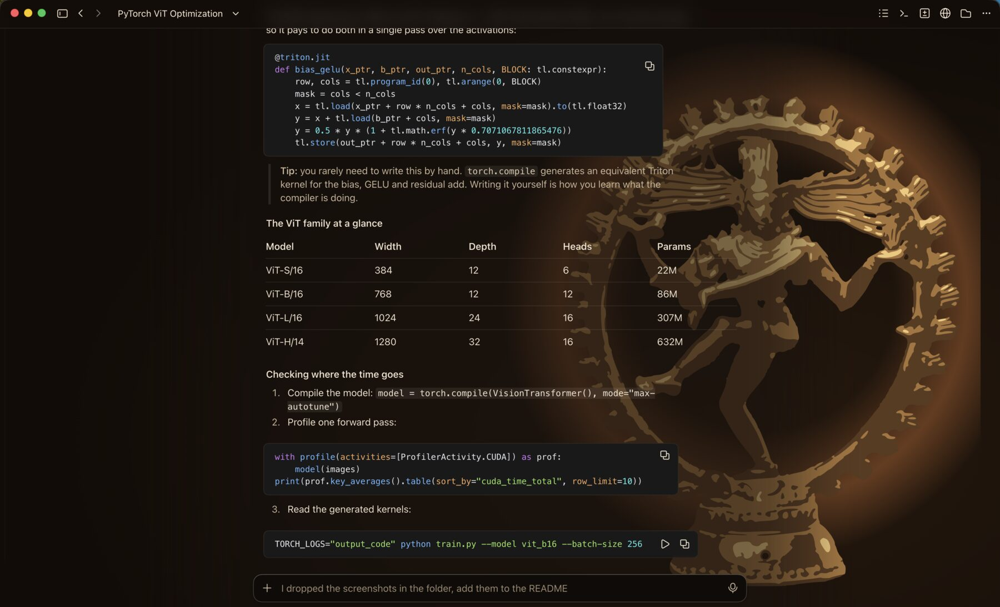

# itihasa-themes

Backdrops for Claude Code from the Hindu epics and Puranas. Each theme comes with a palette to match, and
each has a **still** version (the default) and a **motion** version you can switch on.



## Themes

| Theme | What it shows | Motion version |
|---|---|---|
| `nataraja` | Shiva as Nataraja, Lord of the Dance, inside the ring of fire: a Chola bronze in firelight, with a warm dark-bronze palette | The flames on the ring flare and fade, the firelight breathes, and embers rise from the flame tips. The figure stays still. |

More are on the way: Anantashayana, Indra and Vritra, Samudra Manthan, and Kurukshetra.

## Install

Backdrops draw only in the **Claude desktop app** (Code tab) and the **mobile app**. The terminal and editors
show the palette at most. You need Claude Code 2.1.324 or later; the desktop app ships its own copy, so keep the
app up to date.

From a terminal:

```bash
claude plugin marketplace add <owner>/itihasa-themes
```

```bash
claude plugin install itihasa@itihasa-themes
```

Or in the desktop app: click **+** next to the prompt box, then **Plugins** → **Add marketplace** with
`<owner>/itihasa-themes`, then **Add plugin**.

From a local clone instead: `claude plugin marketplace add /path/to/itihasa-themes`, then the same install
line.

## Use

The theme turns on when a session starts, always **still**. It remembers the last theme you picked.

| Command | What it does |
|---|---|
| `/itihasa` | List the themes and show which one is on |
| `/itihasa nataraja` | Show Nataraja, still (`shiva` works too) |
| `/itihasa motion` | Let the current theme move (`moving` works too) |
| `/itihasa still` | Hold it still again |
| `/itihasa nataraja motion` | Pick a theme and its mode in one go |
| `/itihasa off` | Take the backdrop off. It stays off in new sessions until you pick a theme again |

## Performance

A still backdrop is drawn once, as an image, and costs nothing after that. Any motion makes the app redraw
the whole backdrop, so the motion versions are kept small: only the flames, the glow and a few embers change, five
times a second, all on the same tick. The panels over the backdrop use a plain tint, not blur, because blur
over a moving picture is costly. If your Mac runs warm or you're on battery, stay with the still version.
Motion also stops on its own when the system's **Reduce motion** setting is on.

## How the art is made

The figures are traced from public-domain photographs and prints, not drawn freehand.
[`tools/trace-art.mjs`](tools/trace-art.mjs) cuts the subject from its background, splits it into a few tone
layers, and traces each layer with [potrace](https://potrace.sourceforge.net/). Each scene's settings live in
`sources/<theme>/trace.json`, next to the source image. The scene module (`plugins/itihasa/hooks/scenes/`)
then colours the layers and adds the background and motion.

Claude Code takes at most 131,072 characters for a scene, so every scene is checked against that limit.

## Development

```bash
node tools/render-scenes.mjs
```

renders every theme's still and motion SVG to `tools/preview/` and checks their size.

```bash
tools/shoot.sh tools/preview/nataraja-still.svg 1400 800 panels
```

screenshots one with headless Chrome. Add `panels` for stand-in chat panels on top; use `390 844` for a phone.

```bash
claude plugin validate plugins/itihasa
```

```bash
claude plugin test plugins/itihasa
```

Re-trace art (needs ImageMagick and potrace):

```bash
node tools/trace-art.mjs sources/nataraja/trace.json
```

## Credits and licence

- Code: MIT (see [LICENSE](LICENSE)).
- **Nataraja** is traced from *Shiva as Lord of Dance (Nataraja)*, Chola period, ca. late 11th century, copper
  alloy. The Metropolitan Museum of Art, 1987.80.1, Gift of R. H. Ellsworth Ltd., in honor of Susan Dillon,
  1987. Image released under the Met's Open Access policy (CC0):
  <https://www.metmuseum.org/art/collection/search/39328>
