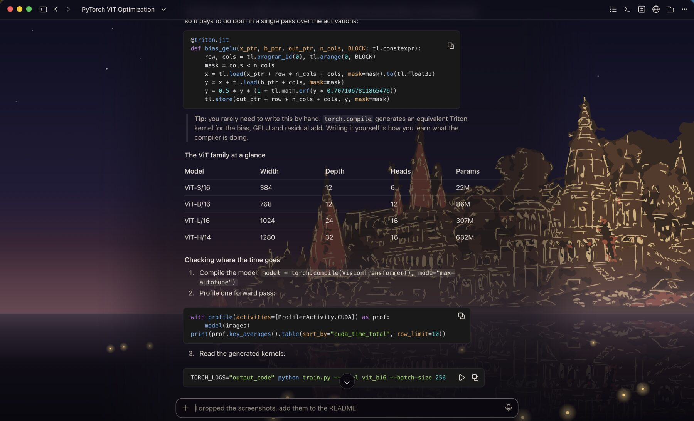
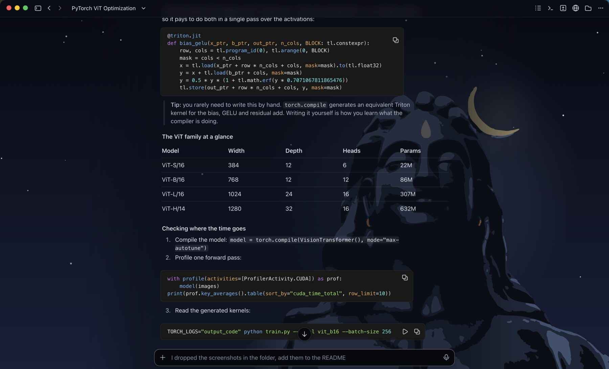

# itihasa-claude-themes

Backdrops for the Claude desktop app from Hindu iconography and sacred places. Each theme has a matching
color palette, a **still** version (the default) and an optional **motion** version.



## Themes

<table>
  <tr>
    <td width="45%"></td>
    <td>
      <b><code>varanasi</code></b><br>
      The ghats of Kashi at dusk, in gold line-work after Edward Lear's 1873 watercolour.<br><br>
      <i>In motion:</i> diyas flicker on the river.
    </td>
  </tr>
  <tr>
    <td width="45%"></td>
    <td>
      <b><code>nataraja</code></b><br>
      Shiva as Lord of the Dance in his ring of fire, traced from a Chola bronze.<br><br>
      <i>In motion:</i> embers rise from the flames.
    </td>
  </tr>
  <tr>
    <td width="45%"></td>
    <td>
      <b><code>adiyogi</code></b><br>
      Shiva as Adiyogi, the first yogi, under a night sky.<br><br>
      <i>In motion:</i> the stars twinkle.
    </td>
  </tr>
</table>

## Before you install

- **Desktop and mobile apps only.** Backdrops draw in the Claude desktop app (Code tab) and the mobile app.
  The terminal and editor extensions show the palette at most.
- **Tested on macOS only**: Apple M4, macOS 26.5, with the desktop app's bundled Claude Code **2.1.325**.
  Claude Code 2.1.324 is the minimum. Windows and Linux are untested; reports are welcome.
- **Motion uses your GPU.** A still backdrop is drawn once and costs nothing after that. Motion makes the app
  redraw the backdrop several times a second for as long as it is on screen, which keeps the GPU busy, warms
  the Mac and drains the battery faster. In our testing on an M4, an animated backdrop took whole-GPU use from
  near idle to 30–45%. That's why every theme starts still. Use motion when you're plugged in, and switch back
  with `/itihasa still`. Motion also stops on its own when macOS **Reduce motion** is on.

## Install

From a terminal:

```bash
claude plugin marketplace add gauthamk02/itihasa-claude-themes
```

```bash
claude plugin install itihasa@itihasa-claude-themes
```

Or in the desktop app: click **+** next to the prompt box, then **Plugins** → **Add marketplace**, enter
`gauthamk02/itihasa-claude-themes`, then **Add plugin**.

To work on themes, install from a clone instead. Claude Code then reads the plugin from your folder, and
`/reload-plugins` picks up your edits:

```bash
git clone https://github.com/gauthamk02/itihasa-claude-themes.git
```

```bash
claude plugin marketplace add ./itihasa-claude-themes
```

```bash
claude plugin install itihasa@itihasa-claude-themes
```

## Use

The last theme you picked comes back, still, each time a session starts.

| Command | What it does |
|---|---|
| `/itihasa` | List the themes |
| `/itihasa varanasi` | Show a theme, still (names like `kashi` and `shiva` work too) |
| `/itihasa motion` | Let the current theme move |
| `/itihasa still` | Hold it still again |
| `/itihasa off` | Remove the backdrop until you pick a theme again |

## Make your own theme

Themes are traced from existing art and drawn as small SVG scenes. [CONTRIBUTING.md](CONTRIBUTING.md)
walks you from a source image to a pull request: tracing, the scene, testing, GPU checks and attribution.

## Report a problem

[Open an issue](https://github.com/gauthamk02/itihasa-claude-themes/issues/new/choose). Include your OS, your Mac's
chip, the Claude desktop app version, the theme, and whether it was still or in motion. A screenshot helps.

## About Claude Code mods

These themes are built on Claude Code mods, which let a plugin change Claude's own interface, including
the backdrop behind the conversation.

- [The announcement](https://x.com/ClaudeDevs/status/2121392666244186327) from Claude Devs on X
- [Mods overview](https://code.claude.com/docs/en/plugins/mods/overview): what a mod is and how to install one
- [Backdrops](https://code.claude.com/docs/en/plugins/mods/interface#put-a-backdrop-behind-the-conversation):
  how a mod puts a scene behind the conversation
- [Mods reference](https://code.claude.com/docs/en/plugins/mods/reference): events, the API and limits

## Credits and licence

Code is MIT ([LICENSE](LICENSE)). Each theme's source art, its licence and what was changed are listed in
[CREDITS.md](CREDITS.md).

This is a fan project. It is not made by or affiliated with Anthropic.
